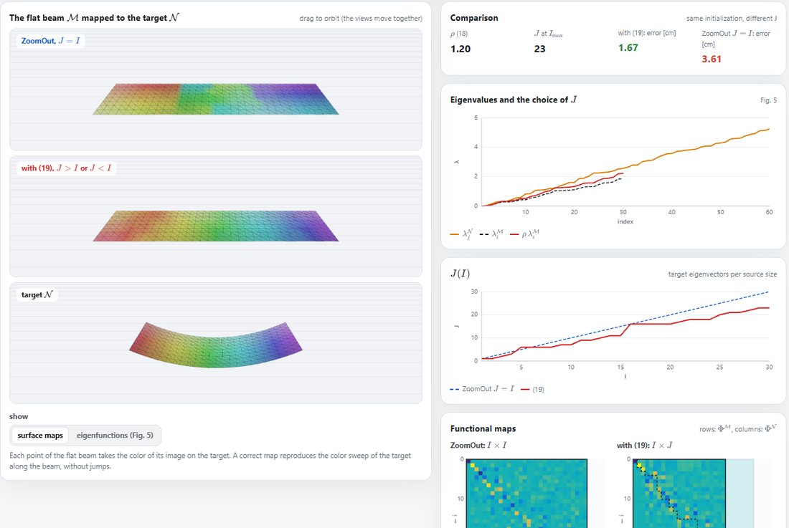
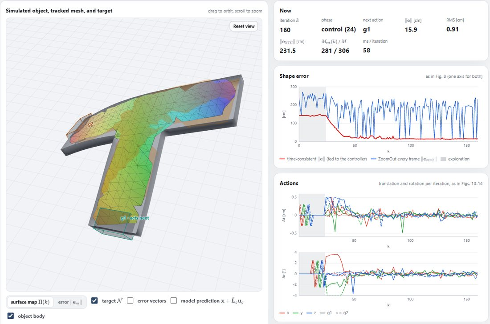

# Time Consistent Surface Mapping for Deformable Object Shape Control

Interactive demos, MATLAB code, and a Python implementation of the paper *Time Consistent Surface Mapping for Deformable Object Shape Control*, by I. Cuiral-Zueco and G. López-Nicolás, IEEE Transactions on Automation Science and Engineering, vol. 22, 2025.

### **[▶ Open the interactive demos](https://ignaciocuiral.com/time-consistent-surface-mapping/)**

[Web version of the paper](https://ignaciocuiral.com/time-consistent-surface-mapping/paper/) · [Video](https://www.youtube.com/watch?v=tWMJCbUwZOM) · [Paper (doi:10.1109/TASE.2025.3529180)](https://doi.org/10.1109/TASE.2025.3529180)

[](https://ignaciocuiral.com/time-consistent-surface-mapping/consistency.html)

Shape control deforms an object into a desired shape with robots. For 3D objects without visual texture or distinctive features, the paper defines the control reference with a surface map between the perceived mesh of the object and the target mesh, computed with functional maps. A map computed anew at every frame is not a usable reference: every frame brings a new mesh, with another number of points in another order, and the map jumps between solutions of similar cost. The method keeps the eigenbasis, the tracked points, and the functional map consistent from one frame to the next (Algorithm 1), copes with targets that are not isometric to the current shape, and runs above 5 Hz; a shape controller then learns the response of the object to each gripper from the tracked points.

## Interactive demos

The demos run in the browser, with no installation. They compute the method on meshes perceived by a simulated depth camera, on foam pieces deformed with ARAP as in the simulations of the paper, and every page shows the equations it computes next to the views.

| Page | Content |
|---|---|
| [Overview](https://ignaciocuiral.com/time-consistent-surface-mapping/) | The method in brief, the video of the paper, its figures, and the code. |
| [1 · Functional maps](https://ignaciocuiral.com/time-consistent-surface-mapping/fmaps.html) | Sec. 2. The Laplace-Beltrami eigenfunctions of two perceived meshes, the functional map C(I) at every step of ZoomOut, the point map it gives, the image of a point selector, and the arbitrary signs of the eigenvectors. |
| [2 · Time consistency](https://ignaciocuiral.com/time-consistent-surface-mapping/consistency.html) | Secs. 3.1-3.3. A deforming object perceived anew at every frame, mapped by ZoomOut from scratch and by the time-consistent method: the ICP initialization, the tracking map C^M(k) with its sign corrections, the tracked points, the warm start, the shape errors (Fig. 8), and the processing time (Fig. 9). Four objects: a foam sheet, a Mexican hat, a sea star, and a T. |
| [3 · Non-isometries](https://ignaciocuiral.com/time-consistent-surface-mapping/nonisometry.html) | Sec. 3.4. A beam mapped to a shorter or longer, bent beam: the eigenvalues and the choice of J (Fig. 5), the slanted functional map, and both maps against the true correspondence (Fig. 6), with a sweep over the stretch. |
| [4 · Shape control](https://ignaciocuiral.com/time-consistent-surface-mapping/control.html) | Sec. 4. The closed loop: the shape error (20), the buffers and the estimated interaction matrices (23), the control law (24) with sequential grippers, the actions (Figs. 10-14), and the point-error distributions (Fig. 15). |

<p align="center">
  <a href="https://ignaciocuiral.com/time-consistent-surface-mapping/nonisometry.html"></a>
  <a href="https://ignaciocuiral.com/time-consistent-surface-mapping/control.html"></a>
</p>

**What is simulated.** Each object is a foam piece of uniform thickness, discretized as a lattice of nodes and deformed with ARAP (Sorkine and Alexa, 2007); the grippers hold the nodes inside their boxes. A depth camera above the object samples its top surface on a pixel grid fixed in the world and meshes neighboring pixels: as the object moves, the points slide over it and their number changes; they are shuffled and carry 0.5 mm of noise. The method sees only these meshes. The simulator also knows which material point every perceived point samples, which the pages use to measure every map against the true correspondence.

**Implementation choices.** The pages follow the equations of the paper. Where the reference MATLAB code differs, they follow the code and say so, and the page *Time consistency* runs both under *Implementation variants*:

- *Tracking (Sec. 3.2).* Read literally, (14)-(15) re-read the basis and the points on the rows that Π^M(k) selects. Π^M(k) is not one-to-one, so tracked points that select the same new point carry the same embedding from then on and merge (in the demos, about a third of them within 80 frames). The reference code aligns the basis of every new mesh with the whole map C^M(k) between consecutive meshes (which also undoes rotations between eigenvectors of nearly equal eigenvalues, as on the disc of the Mexican hat) and finds each tracked point by its embedding at k = 1; the demos do the same by default.
- *Refinement step.* Algorithm 1 increases I by one per step; the code by 4 (`Cstep`), as the pages by default (page 1 and page 3 use steps of one).
- *Control law.* Equation (23) is printed with −γI₆; as a Tikhonov regularization it adds γI₆. Its size matters: near the target, the responses Δx are mostly sampling noise, and with a negligible γ the estimate degrades and the loop stalls. The demos use γ = 0.2 cm², with the rotations of the actions scaled by a lever of 10 cm.
- *Non-isometries.* In the simulations of page 3, the rule (19) gives clearly better maps for compressed targets (where it gives J < I) and makes little difference near equal areas; for strong stretches, either map can come out better. The page computes both, with a sweep.

### Run the demos locally

The pages are static files in `docs/`, with KaTeX and three.js included; any web server works, and GitHub Pages serves them from this folder.

```bash
python run.py                  # serves docs/ and opens http://127.0.0.1:8765/ (Python standard library only)
python tools/build_web.py      # after editing the sources in docs/ (needs Node.js; npx fetches esbuild)
node tests/test_sim.mjs        # checks of the simulation modules (Node.js, about 20 s)
```

Each page is a single HTML file that contains its style sheets, scripts, and figures: the build fills the blocks marked `data-inline` from the ES modules and the style sheet, so that a page also opens from the disk.

| Path | Content |
|---|---|
| `docs/*.html` | The pages and their lesson text. |
| `docs/js/sim/` | The method and the simulator: cotangent Laplacian and eigenbasis (shift-and-invert Lanczos), functional maps and ZoomOut with the rule (19), ICP, Algorithm 1 with its tracking variants, the shape controller, ARAP, the foam pieces, and the depth camera. These modules also run in Node.js. |
| `docs/js/lib/`, `docs/js/pages/` | The 3D views (three.js), the charts, the controls, and one module per page. |
| `docs/img/` | Figures of the paper. |
| `docs/paper/` | The web version of the paper. |
| `tools/`, `tests/` | The build script and the checks of the simulation modules. |

## MATLAB implementation

The MATLAB code reproduces the surface mapping results of the five experiments of the paper from the recorded meshes:

- **`timeconsistentsurfacemapping.m`**: main script. For every experiment, it maps every recorded mesh to the target with the method (`initialisefmap.m`, `previousstatefmap.m`, `updatefmap.m`, `refinenonisometric.m`) and with ZoomOut (`classicZoomout.m`), and plots the surface maps, the shape errors, the processing times, and the mesh sizes.
- **`objectsurfacemeshing.m`**: how the meshes in `data/` were built from the segmented point clouds (grid downsampling and ball pivoting).
- **`utils/`**: mesh-analysis utilities of [ZoomOut](https://github.com/llorz/SGA19_zoomOut).
- **`data/`**: the meshes of the five experiments (`.mat`) and their videos (`.mp4`): a Mexican hat, a T-shaped pool noodle, a pillow, a rectangular foam sheet, and a foam cut-out.


It requires MATLAB (R2022b recommended) with the Statistics and Machine Learning, Computer Vision, Lidar, and Optimization toolboxes. The `.mat` files are stored with Git LFS: **clone** the repository (`git clone https://github.com/nachocz/time-consistent-surface-mapping`) with Git LFS installed; a ZIP download does not contain the data.

## Python implementation

A Python implementation of the method (Laplace-Beltrami basis, functional maps and ZoomOut, Algorithm 1 with its tracking, the rule (19), and the control law of Sec. 4.1), with a 3D viewer of the recorded experiments, is in [`python/`](python/README.md):

```bash
pip install -r python/requirements.txt
python python/demo.py --experiment 5             # 3D viewer (Polyscope)
python python/demo.py --experiment 1 --no-gui    # summary of the whole sequence
```

## Experimental setup

The experiments were conducted with two ABB IRB120 robots with pneumatic grippers, a diffused light source, and an Intel RealSense D415 RGB-D camera; the objects were segmented in the CIELAB color space.


## Citation

If you find this work useful, please cite:

> I. Cuiral-Zueco and G. López-Nicolás, "Time Consistent Surface Mapping for Deformable Object Shape Control," *IEEE Transactions on Automation Science and Engineering*, vol. 22, pp. 11099-11111, 2025, [doi: 10.1109/TASE.2025.3529180](https://doi.org/10.1109/TASE.2025.3529180).

```bibtex
@ARTICLE{10839391,
  author = {Cuiral-Zueco, Ignacio and López-Nicolás, Gonzalo},
  title = {Time Consistent Surface Mapping for Deformable Object Shape Control},
  journal = {IEEE Transactions on Automation Science and Engineering},
  year = {2025},
  volume = {22},
  pages = {11099-11111},
  doi = {10.1109/TASE.2025.3529180}
}
```

## Authors

- [Ignacio Cuiral-Zueco](https://ignaciocuiral.com/)
- [Gonzalo López-Nicolás](http://webdiis.unizar.es/~glopez)

Instituto de Investigación en Ingeniería de Aragón (I3A), Universidad de Zaragoza, Spain.

## License

This repository is released under the Creative Commons Attribution-NonCommercial 4.0 International License (see `LICENSE`). The utilities in `utils/` come from the [ZoomOut repository](https://github.com/llorz/SGA19_zoomOut); KaTeX and three.js keep their MIT licenses (`docs/vendor`); and the optional background music of the demos keeps the licenses listed in `docs/audio/CREDITS.md`.

## Acknowledgements

This work was supported via project REMAIN S1/1.1/E0111 (Interreg Sudoe Programme, ERDF) and projects PID2021-124137OB-I00 and TED2021-130224B-I00 funded by MCIN/AEI/10.13039/501100011033, by ERDF A way of making Europe and by the European Union NextGenerationEU/PRTR.


The interactive demos and the Python implementation were developed with the assistance of Claude (Anthropic), an AI model, which wrote and tested the code and drafted the text of the pages under the direction of the authors.
